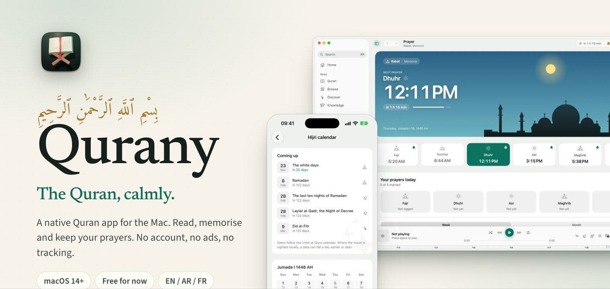
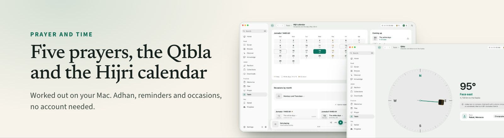
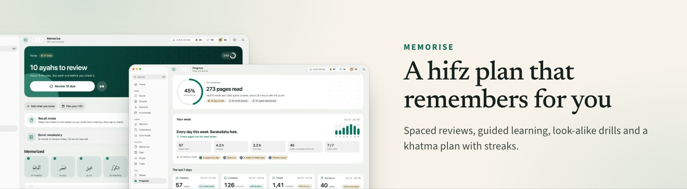
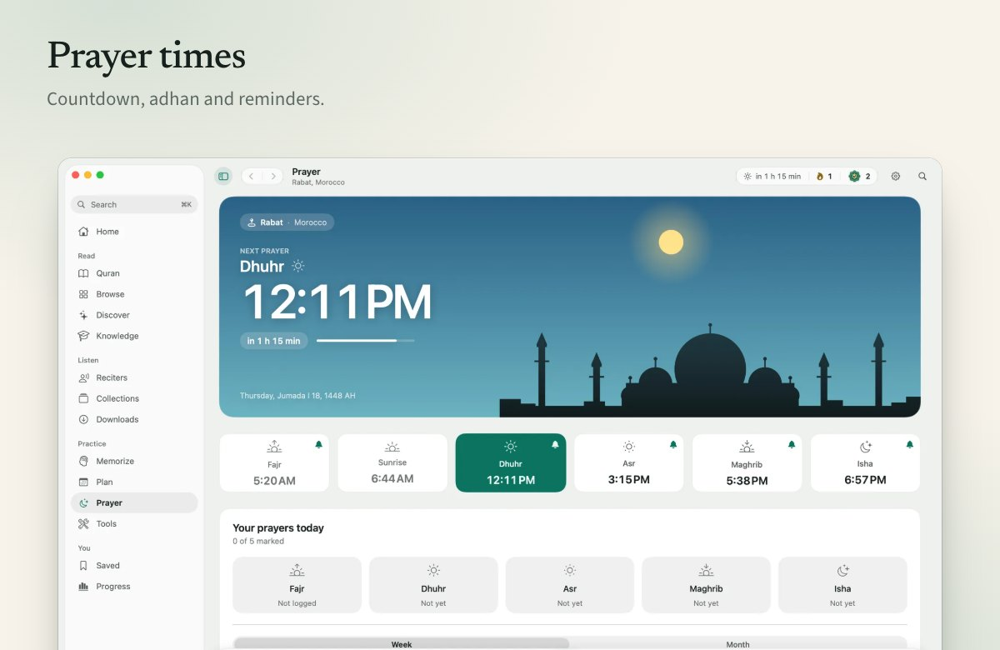
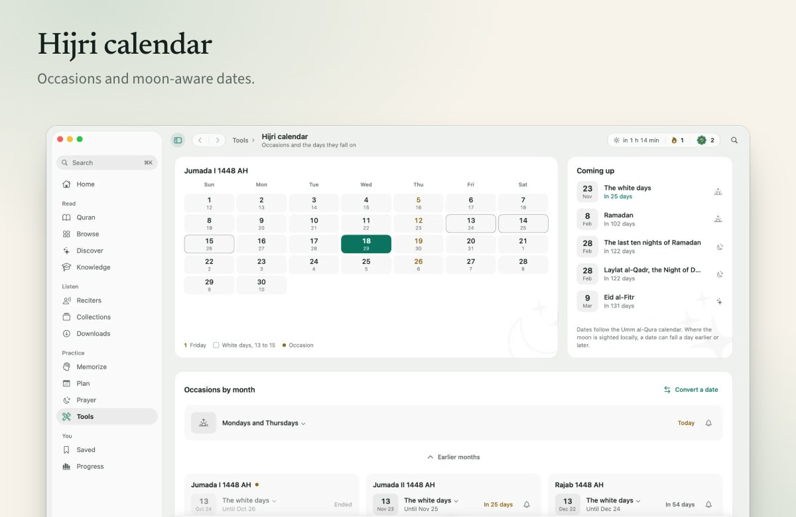
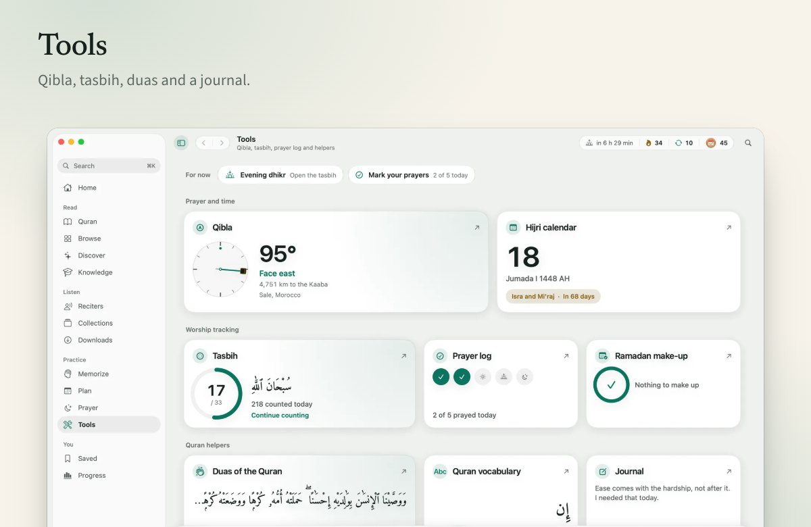
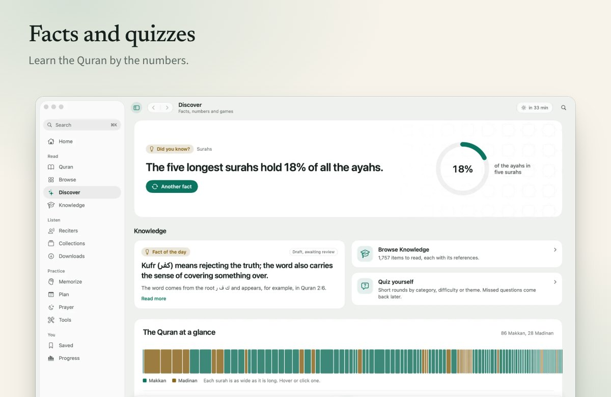
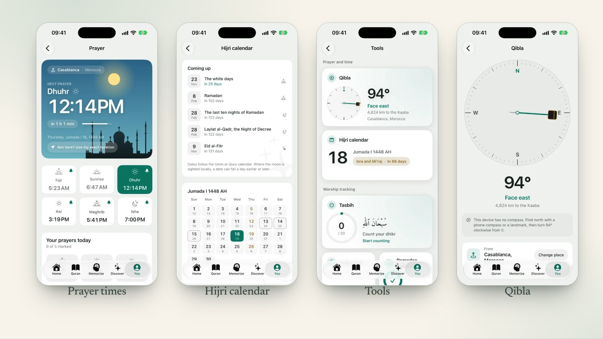
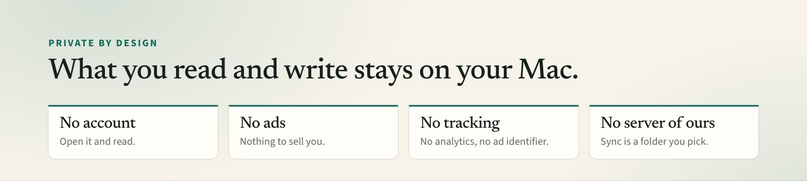

<div align="center">


# Qurany

**The Quran, calmly.**

A native Quran app for the Mac. Read, memorise and keep your prayers.<br>
No account, no ads, no tracking. In English, Arabic and French.

<br>

[](https://github.com/Zawalid/qurany-app/releases/latest/download/Qurany.dmg)


[](LICENSE)

[Website](https://qurany.zawalid.com) &nbsp;&middot;&nbsp; [Install](#install) &nbsp;&middot;&nbsp; [What is in this version](#what-is-in-this-version) &nbsp;&middot;&nbsp; [Privacy](#privacy) &nbsp;&middot;&nbsp; [FAQ](#faq) &nbsp;&middot;&nbsp; [Support](#support)

<br>

<picture>
  <source media="(prefers-color-scheme: dark)" srcset="assets/hero-dark.jpg">
  
</picture>

</div>

<br>

> [!NOTE]
> Qurany is at its first public releases, so expect rough edges. This first public version holds only content whose
> licence is confirmed, so it has **no recitation, translation or tafsir yet**.
> [What is in this version](#what-is-in-this-version) says exactly what is there and what is not.

## Why Qurany

Most Quran apps want an account, show ads or watch what you do. Qurany is a quiet Mac app that works the other way:
it opens straight to your place, keeps everything on your Mac, and stays out of the way of the reading.

- **Calm.** Five themes, three Arabic fonts, focus mode and auto-scroll. No badges shouting at you.
- **Native.** Written in SwiftUI for the Mac. Light, fast, and it follows your system.
- **Yours.** No account and no server of ours. Your notes, bookmarks and progress never leave your Mac.

<br>

<picture>
  <source media="(prefers-color-scheme: dark)" srcset="assets/strip-prayer-dark.jpg">
  
</picture>

<picture>
  <source media="(prefers-color-scheme: dark)" srcset="assets/strip-memorise-dark.jpg">
  
</picture>

## A closer look

<table>
  <tr>
    <td width="50%" align="center">
      <picture>
        <source media="(prefers-color-scheme: dark)" srcset="assets/tile-prayer-dark.jpg">
        
      </picture>
    </td>
    <td width="50%" align="center">
      <picture>
        <source media="(prefers-color-scheme: dark)" srcset="assets/tile-hijri-dark.jpg">
        
      </picture>
    </td>
  </tr>
  <tr>
    <td width="50%" align="center">
      <picture>
        <source media="(prefers-color-scheme: dark)" srcset="assets/tile-tools-dark.jpg">
        
      </picture>
    </td>
    <td width="50%" align="center">
      <picture>
        <source media="(prefers-color-scheme: dark)" srcset="assets/tile-discover-dark.jpg">
        
      </picture>
    </td>
  </tr>
</table>

<picture>
  <source media="(prefers-color-scheme: dark)" srcset="assets/phones-dark.jpg">
  
</picture>

<sub>The iPhone version is shown for context. It is not part of this download and has no public release yet.</sub>

## Install

<table>
  <tr>
    <td width="33%" valign="top"><b>1. Download</b><br>Get <a href="https://github.com/Zawalid/qurany-app/releases/latest/download/Qurany.dmg"><code>Qurany.dmg</code></a> from the <a href="../../releases/latest">latest release</a>.</td>
    <td width="33%" valign="top"><b>2. Drag to Applications</b><br>Open the disk image and drag Qurany into the Applications folder.</td>
    <td width="33%" valign="top"><b>3. Confirm the first launch</b><br>macOS asks you to confirm once. That is expected, <a href="#first-launch-macos-asks-you-to-confirm">see below</a>.</td>
  </tr>
</table>

Requires macOS 14 Sonoma or later, on Apple silicon or Intel.

### First launch: macOS asks you to confirm

Qurany is not notarized by Apple, because there is no paid Apple Developer account behind the project. macOS cannot
check it, so it blocks the first launch with "Apple could not verify Qurany is free of malware". That message is about
the missing notarization, not a finding about the app. You confirm once and macOS remembers.

<details>
<summary><b>macOS 15 Sequoia and later</b></summary>

<br>

1. Open Qurany from Applications. When the warning appears, click Done. Do not choose Move to Trash.
2. Open System Settings, then Privacy & Security, and scroll down to Security.
3. Qurany is listed as blocked. Click Open Anyway, confirm with your password or Touch ID, then click Open.

On macOS 15 and later, right-click then Open no longer skips the check. Open Anyway in System Settings is the
supported way.

</details>

<details>
<summary><b>macOS 14 Sonoma</b></summary>

<br>

1. In Applications, right-click Qurany and choose Open.
2. Click Open in the dialog. You only do this once.

</details>

<details>
<summary><b>Prefer the Terminal?</b></summary>

<br>

If you trust this download, this removes the quarantine flag:

```bash
xattr -dr com.apple.quarantine /Applications/Qurany.app
```

</details>

<details>
<summary><b>Check your download</b></summary>

<br>

Each release has a `.sha256` file. Put it next to the disk image and run, in that folder:

```bash
shasum -a 256 -c Qurany-0.1.0.dmg.sha256
```

Replace the version with the one you downloaded. It should print `OK`.

</details>

## What is in this version

<table>
  <tr>
    <th width="50%" align="left">In it</th>
    <th width="50%" align="left">Not in it yet</th>
  </tr>
  <tr>
    <td valign="top">

- **Read**: the Arabic text (Tanzil Uthmani) as a verse list, juz, surah and page navigation, five themes, three Arabic fonts, focus mode and auto-scroll.
- **Understand**: surah introductions, a knowledge library with quizzes, duas of the Quran, facts and statistics, and a search that ignores diacritics (Arabic) with go-to such as `2:255`, `page 50` or `juz 5`.
- **Memorise**: a hifz plan with a calendar, spaced reviews, guided learning, look-alike ayah drills, saved words with flashcards, and recite aloud with speech recognition.
- **Daily life**: prayer times, adhan and reminders, Qibla, Hijri calendar, tasbih, habits, journal, a khatma plan with streaks, and awards.
- **Share**: turn an ayah into a picture card in several styles and sizes.
- **Keep your own data**: bookmarks with folders, notes and highlights, export and import as one file, and optional sync between devices through a folder you choose.

</td>
    <td valign="top">

- Recitation, with its player, reciters, collections and downloads.
- Translations (Saheeh International, Muhammad Asad, Hamidullah) and tafsir (Al-Muyassar, Al-Jalalayn).
- The 604-page Mushaf layout (the verse list remains), and the page recital test that needs it.
- Tajweed colouring, word meanings and transliteration, roots, lemmas and the vocabulary flashcards.
- Topics, themes, similar ayahs and mutashabihat.
- Hadith grades on the knowledge cards, two page-turn sounds and some reciter photographs.

<sub>The licence of these is not confirmed, so the app is built without them, and each one is checked out of the download before a release. When a permission arrives, that content comes back in a new version and this list gets shorter.</sub>

</td>
  </tr>
</table>

## Status

- **Not notarized.** The app is signed ad hoc, not with a paid Apple Developer ID, so macOS asks you to confirm the
  first launch. See [First launch](#first-launch-macos-asks-you-to-confirm).
- **Releases start as drafts.** A version appears here only after it has been tried on a clean Mac account.
- **Draft text.** French and Arabic wording is still waiting for a native read, and the surah introductions and the
  knowledge cards are marked as drafts in the app until they have been reviewed. Please report anything that reads
  wrongly.
- **Only cleared content.** Recitation, translations, tafsir and several datasets are left out until their publishers
  give permission. They are not hidden in the download: the app is built without them and checked before each release.
  [THIRD_PARTY_NOTICES.md](THIRD_PARTY_NOTICES.md) lists each one and its state.
- **Free for now.** Qurany costs nothing today. This may change in a future version, and any change will be written
  here and on the website before it happens.

## Privacy

<picture>
  <source media="(prefers-color-scheme: dark)" srcset="assets/strip-privacy-dark.jpg">
  
</picture>

The short version: no account, no analytics, no advertising identifier, no server of ours. What you read, mark,
memorise and write stays on your Mac.

What can leave your Mac, and when:

| What | Sent to | When |
| --- | --- | --- |
| Your approximate location | api.aladhan.com | Only if you turn on exact prayer times. Otherwise times are worked out on your Mac and location is not used. |
| Your voice | Apple | Only while you recite aloud, and only if you allow online recognition. Qurany stores nothing. |

Sync is off until you pick a folder. If you do, Qurany keeps a small file per device in that folder, and the folder's
own service (iCloud Drive, Dropbox, Syncthing) moves it. The app is sandboxed. Location, microphone and speech
recognition are asked for only when you use the feature that needs them. The full statement is at
https://qurany.zawalid.com/privacy/.

## FAQ

<details>
<summary><b>Why does macOS say it cannot verify Qurany?</b></summary>

<br>

Because the app is not notarized, and notarization needs a paid Apple Developer account that is not behind this
project. The message is about that, not about what the app does. See
[First launch](#first-launch-macos-asks-you-to-confirm) for the steps.

</details>

<details>
<summary><b>Is it free?</b></summary>

<br>

Yes, for now. This may change in a future version, and any change will be written here and on the website before it
happens.

</details>

<details>
<summary><b>Where is the source code?</b></summary>

<br>

In a private repository. This repository only holds the downloads and this page, so there is no source here to read or
build.

</details>

<details>
<summary><b>Why is there no recitation or translation?</b></summary>

<br>

Their publishers have not yet confirmed that Qurany may redistribute them. Until they do, the app is built without
them. [THIRD_PARTY_NOTICES.md](THIRD_PARTY_NOTICES.md) lists each item and its state.

</details>

<details>
<summary><b>How do I update?</b></summary>

<br>

For now, download the new version and replace the app in Applications. Your reading position, bookmarks, notes and
settings stay.

</details>

<details>
<summary><b>Which languages does it speak?</b></summary>

<br>

English, Arabic (right to left) and French. Change it in Settings.

</details>

## Credits

Qurany stands on the work of others. The Arabic text is from the Tanzil Project (CC BY 3.0). Word timing data is
quran-align by Collin Fair (CC BY 4.0). Fonts are Amiri Quran, Amiri and Scheherazade New (SIL Open Font License).
Adhan recordings and reciter photographs are from Wikimedia Commons, with their authors and licences in
THIRD_PARTY_NOTICES.md. Every item, its licence and what is still unconfirmed is in
[THIRD_PARTY_NOTICES.md](THIRD_PARTY_NOTICES.md), and the website lists them at https://qurany.zawalid.com/sources/.

## Support

Open an [issue](../../issues) on this repository. Please say your macOS version, the Qurany version (Qurany menu,
About Qurany) and what you were doing. For a wrong translation, introduction or fact, say which ayah or page.

## Licence

Qurany is free to use but is not open source. See [LICENSE](LICENSE). In short: personal use, no resale, no
redistribution of the app or its data.

<br>

<div align="center">


<sub>Made with care by <a href="https://github.com/Zawalid">Zawalid</a> &nbsp;&middot;&nbsp; <a href="https://qurany.zawalid.com">qurany.zawalid.com</a></sub>

<sub>The code is in a private repository. This repository exists to host downloads and this page, and nothing else.</sub>

</div>
